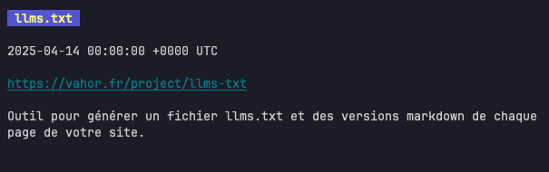

# Qu'est-ce que le rss ?

Le rss est un fichier XML qui contient des informations sur vos articles, et est utilisé pour suivre les actualités d'un site.

Par exemple, sur ce site cela donne [rss.xml](https://vahor.fr/rss.xml).\
N'importe qui peut s'abonner à ce flux, ainsi dès qu'un nouveau post est publié la personne n'aura qu'à actualiser son flux pour voir qu'il y a de nouveaux articles.

# Comment générer un fichier rss.xml ?

Avec Astro, la fonction suivante utilise `@astrojs/rss` pour construire la réponse XML :

@include "../../../scripts/generate-rss.ts"

L'endpoint `src/pages/rss.xml.ts` appelle cette fonction avec les articles et l'URL du site. Astro génère ensuite `/rss.xml` pendant le build :

@include "../../../src/pages/rss.xml.ts"

Voir la [documentation de `@astrojs/rss`](https://docs.astro.build/en/recipes/rss/).

# Comment voir si ça marche ?

Pour tester j'ai utilisé la cli [nom](https://github.com/guyfedwards/nom)

```bash title="Comment utiliser nom ?"
nom add https://vahor.fr/rss.xml
nom
```




On se retrouve maintenant avec un [sitemap.xml](https://vahor.fr/sitemap.xml), un [llms.txt](https://vahor.fr/llms.txt) et un [rss.xml](https://vahor.fr/rss.xml), je pense que les 5 articles du site ont assez de visibilité 🤣
